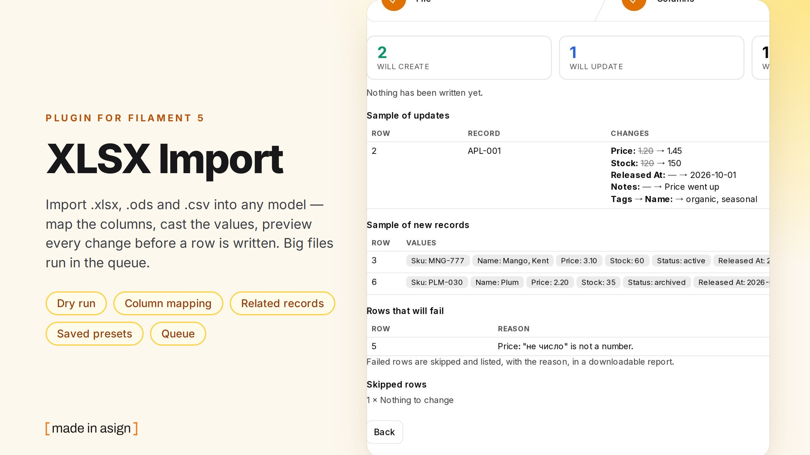
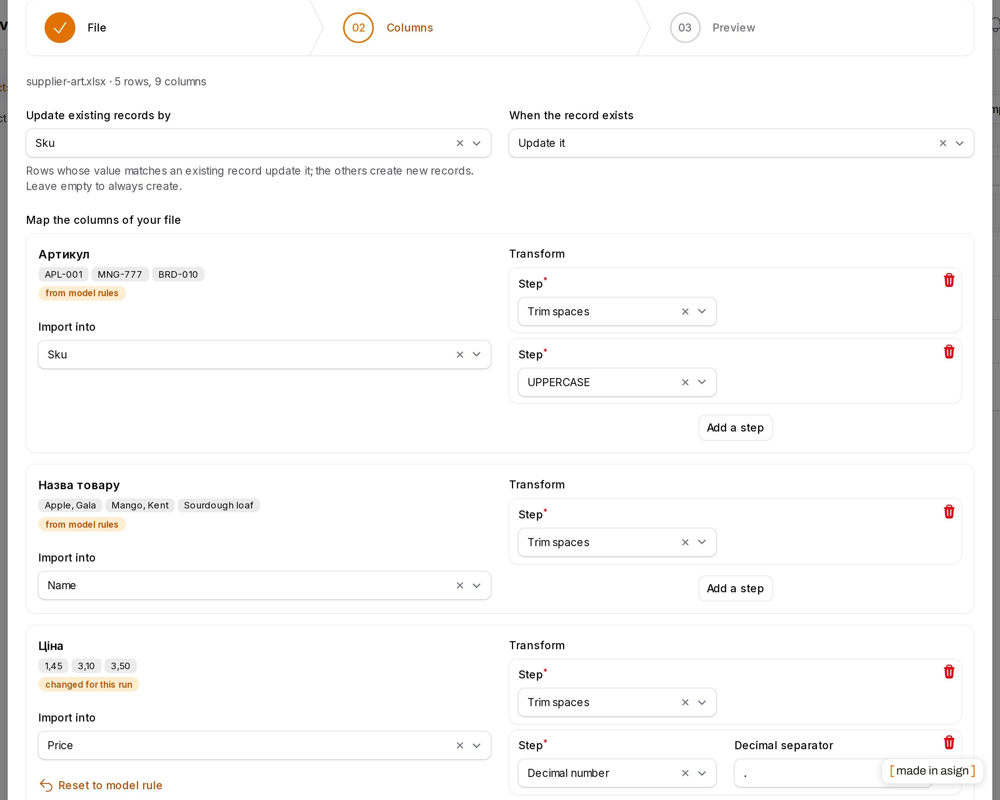
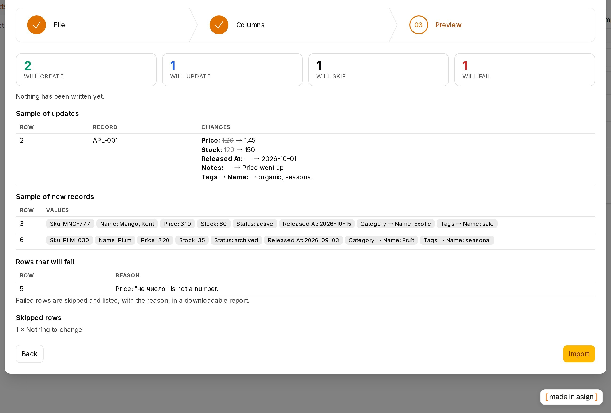
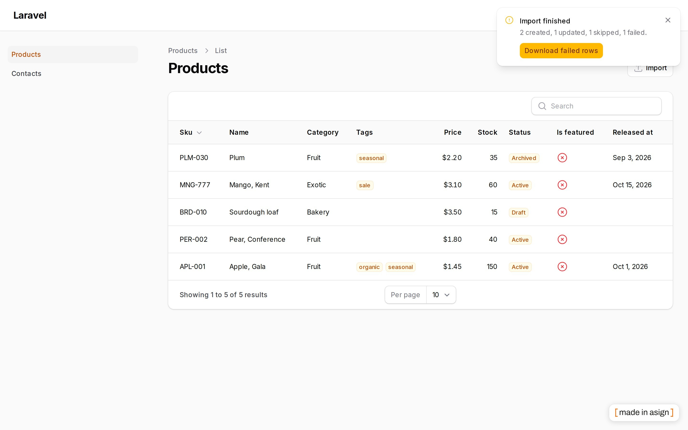
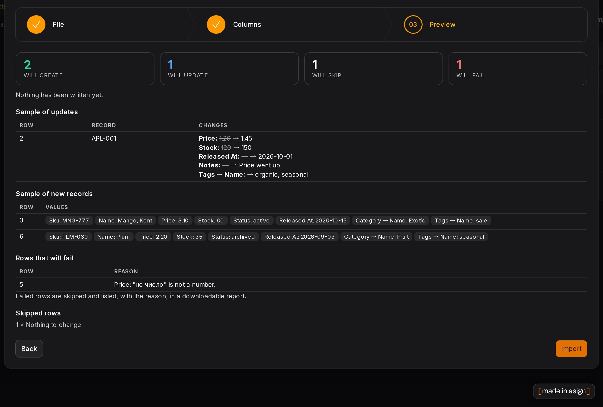

# Filament XLSX Import

[](https://stand-with-ukraine.pp.ua)
[](https://packagist.org/packages/asignua/filament-xlsx-import)
[](https://github.com/asignua/filament-xlsx-import/actions/workflows/tests.yml)
[](https://github.com/asignua/filament-xlsx-import/blob/main/LICENSE.md)



Import `.xlsx`, `.ods` and `.csv` into **any Eloquent model** from a Filament 5 panel. Upload a file, see **its** columns
with a few sample values, pick for each one where it goes (an attribute, a field of a related record, or nothing), choose
the casts, **preview every change without writing a row**, then apply — inline, or in the queue for big files.

It is the import companion of [filament-xlsx-export](https://github.com/asignua/filament-xlsx-export) and a maintained
successor of `eightynine/filament-excel-import` (Filament 4 only, [issue #63](https://github.com/eighty9nine/filament-excel-import/issues/63)).

- Zero config: point it at a model. The targets follow what the model declares (`$fillable` / guarded), its `$casts` and its `belongsTo` / `hasOne` relations — **conservative, not safe**: see [What a file may write to](#what-a-file-may-write-to) and list the targets explicitly for user-, role- and billing-like models. A Filament `Importer` class is optional — and works as it is when you have one.
- **Dry run** with a «will create / update / skip / fail» summary and the field-level diff of the updates, before anything is written.
- **Casts per column** (trim, case, integer, decimal with `,` or `.`, yes/no incl. `так/ні`, date with a source format, enum value tables, JSON, split to a list, default, regex), chained, pre-selected from the model's `$casts`.
- **Model rules** (`DefinesImport`): aliases, casts, validation, upsert key, relation behaviour — pre-filled and marked «from model rules»; the user may change them **for one run**, with «Reset to model rule».
- **Saved presets**: name a mapping, pick it at upload next time — matched by header, so the column order may change.
- **Queue** above a threshold: one background job, committed every N rows, a database notification with a signed link to the failed rows.
- **Failed-rows report** as `.xlsx` (source row number, the original columns, the reason); every cell is text, so a `=HYPERLINK(…)` in the upload stays inert.
- **Template download**: a blank `.xlsx` with the headers, an example row and real dropdowns for enum columns.
- CSV: BOM, UTF-16/32, Windows-1251/1252 detected, delimiter sniffed; sheet picker for workbooks.
- Works with mass assignment **off** (attributes are assigned explicitly) and with repository-only apps (`->saveUsing()`).
- English and Ukrainian interface.

- [Screenshots](#screenshots)
- [Requirements](#requirements)
- [Installation](#installation)
- [Usage](#usage)
- [What a file may write to](#what-a-file-may-write-to)
- [Model rules](#model-rules)
- [Casts](#casts)
- [Related records](#related-records)
- [Relation managers](#relation-managers)
- [Fixed values](#fixed-values-for-every-row)
- [Upsert](#upsert-by-key)
- [Dry run](#dry-run)
- [Queue](#queue)
- [Failed rows and template](#failed-rows-and-template)
- [Presets](#presets)
- [Writing your own way](#writing-your-own-way)
- [Limits and authorization](#limits-and-authorization)
- [Configuration](#configuration)
- [Compared to the alternatives](#compared-to-the-alternatives)
- [Migrating from eightynine/filament-excel-import](#migrating-from-eightyninefilament-excel-import)
- [Pairing with xlsx-export](#pairing-with-xlsx-export)
- [Not in 1.0](#not-in-10)

## Screenshots









## Requirements

- PHP 8.3+
- Laravel 12 or 13
- Filament 5 (tested on 5.11)

## Installation

```bash
composer require asignua/filament-xlsx-import
```

Optional, for [presets](#presets):

```bash
php artisan vendor:publish --tag=filament-xlsx-import-migrations
php artisan migrate
```

Optional: `--tag=filament-xlsx-import-config`, `--tag=filament-xlsx-import-translations`, `--tag=filament-xlsx-import-views`.

The panel needs `->databaseNotifications()` for the [queue](#queue) notifications (the import still runs without it).

## Usage

```php
use Asignua\FilamentXlsxImport\Actions\XlsxImportAction;

protected function getHeaderActions(): array   // a ListRecords page; also works in a table's headerActions()
{
    return [
        XlsxImportAction::make()->only(['sku', 'name', 'price'])->updateBy('sku'),   // the page's model, an explicit allowlist
        // XlsxImportAction::make()->model(Product::class),                           // a model that declares $fillable / $guarded = []
        // XlsxImportAction::make()->importer(ProductImporter::class),                // an existing Filament Importer
    ];
}
```

**The model must say what a file may write to.** With `$fillable` (that list) or `$guarded = []` (every column that is not a key or a secret — Laravel's semantics) the action works with no more configuration. A *fully guarded* model (`$guarded = ['*']`, or neither property) has nothing to offer: the button is **not shown** (and with `app.debug` on the page throws a message that tells the developer to add `->only([...])` / `'targets'`). For account, privilege and billing-like models always pass `->only()` even when the model is unguarded.

The modal has three steps: **File** (upload, sheet, CSV encoding/delimiter, a saved preset, «Download a blank template»),
**Columns** (the mapping) and **Preview** (the dry run, then «Import»).

With an `Importer` class its columns are the targets, its `resolveRecord()`, validation rules, hooks and options form run
as they are; the plugin only puts the mapping and casts in front of it. No `imports` table is needed. For the Importer the
upsert is whatever its `resolveRecord()` does; `->updateBy()` is for the model mode.

## What a file may write to

An import runs with `forceFill()` (so mass assignment can stay off). That makes the list of targets a security decision. **Zero config follows what the developer declared, and it is conservative — not safe by itself.**

- A model with a non-empty **`$fillable`**: exactly that list.
- A model with `$guarded = [...]` (not `['*']`): every column that is not guarded.
- A **totally guarded model** — `$guarded = ['*']`, or Eloquent's default with neither property (eEgnith's models are like this): **nothing is offered**. The import refuses to start and says, to the developer, to declare it: `->only([...])` on the action or `'targets'` in `importRules()`.
- On top of that, never offered, whatever the model says: the primary key, timestamps and `deleted_at`, `$hidden` attributes, names that look like secrets or privileges (`password`, `*_token`, `*_secret`, `two_factor_*`, `is_admin`, `role`… — camelCase read as snake_case), the tenant ownership column under tenancy, **JSON columns** and **integer `*_id` foreign keys** (reach those through the relation lookup).
- **Relations:** only `belongsTo` and `hasOne`; `belongsToMany` only when you name it (`->relations(['tags'])`). Related fields follow the same declaration rules **on the related model** (its `$fillable`/guarded, or list `relation.field` in `only`). The app's **login model** (`auth.providers.*.model`) and role/permission models are never discovered as a relation target; `->relations(['account'])` plus the field in `only` is the only way.
- The upsert key can only be one of the offered attributes (never the primary key), and the server re-checks every target and the key against that list, whatever the browser sends.

```php
XlsxImportAction::make()->model(Member::class)->only(['name', 'email', 'phone'])->updateBy('email');   // an explicit allowlist
XlsxImportAction::make()->model(Product::class)->except(['cost_price'])->relations(['tags']);
// or in DefinesImport::importRules(): 'targets' => [...], 'except' => [...], 'relations' => [...]
```

`only()` may list the primary key or a secret: that is then your decision. **For user-like, role-like and billing-like models always list the targets explicitly** — flags such as `is_active`, `level`, `plan` cannot be recognised by name.

**Authorization.** `->authorizeRecords()` checks the model policy for every row — `update` *after* the new values are in the model and before it is saved. It is **on by default when a policy is registered for the model** (`->authorizeRecords(false)` switches it off); without a policy rows are not checked, as in Filament's own importer. **Writing into a related record** (`hasOne`) is a write to that model: its `update` policy for an existing record, its `create` policy for a new one — without a policy it is refused. `->allowCreatingRelated()` is about **creating only** and never waives the `update` check; the dangerous, separately named `->allowUpdatingRelatedWithoutPolicy()` does.

**Related records.** «Create it» is a request, not a permission: a rule with `'mode' => 'lookup'` locks the relation (unless it also says `'allow_create' => true`), and creating needs the related model's `create` policy for the user — otherwise the option is not offered (the screen says why) and the server refuses it anyway. Attaching to a parent requires `update` on the parent (the check above).

**Tenancy.** With a Filament tenant the lookup of existing records, the lookups and creations of related records are scoped to the current tenant (through the panel's ownership relationship), new records are stamped with it, and the tenant is restored in the queue worker. `->relatedQueryUsing(fn (Builder $query, string $relatedClass) => …)` narrows related lookups further (or covers models without the ownership relationship).

## Model rules

A model (or a separate class listed in `config('filament-xlsx-import.definitions')` or `->definition(Class::class)`) can
predefine the import:

```php
use Asignua\FilamentXlsxImport\Contracts\DefinesImport;

class Product extends Model implements DefinesImport
{
    public static function importRules(): array
    {
        return [
            'update_by' => 'sku',
            'targets' => ['sku', 'price', 'released_at', 'category.name', 'tags.name'],   // a guarded model must say what a file may write to
            'relations' => ['tags'],
            'fields' => [
                'sku' => ['aliases' => ['article', 'артикул'], 'casts' => ['trim', 'upper'], 'rules' => ['required', 'max:40'], 'required' => true],
                'price' => ['casts' => ['trim', ['type' => 'decimal', 'arg' => ',']], 'rules' => ['numeric', 'min:0']],
                'released_at' => ['casts' => [['type' => 'date', 'arg' => 'd.m.Y']]],
                'category.name' => ['mode' => 'create'],                       // find or create the category
                'tags.name' => ['casts' => ['split:;'], 'many' => 'add'],     // ';'-separated, added to the existing ones
            ],
        ];
    }
}
```

Besides `fields`: `targets` / `except` / `relations` (see [What a file may write to](#what-a-file-may-write-to)). Per field: `aliases` (header synonyms), `casts`, `rules` (Laravel validation, applied to the cast value), `required` (the column
must be mapped), `mode` (`lookup` or `create`, for related records), `many` (`add` or `replace`, for many-to-many).
The same array shape works in `XlsxImportAction::make()->fieldRules([...])->updateBy('sku')->aliases([...])` for one action.

What the rules chose is **pre-filled and marked «from model rules»** on the mapping screen. The user can change any of it
for the current import only (the badge turns into «changed for this run») and bring it back with «Reset to model rule».
The definition itself is never modified.

Headers are matched in this order: the field name or label, your aliases, built-in synonyms (en, uk, de, pl, fr, es — see
`resources/aliases.php`, extend with `config('filament-xlsx-import.aliases')`), a header that starts with an alias
(«Назва товару» for «назва»), then a near miss («Emial»). A target is never taken twice.

## Casts

A pipeline of steps per mapped column. Chosen in the UI, predefined in rules (`'trim'`, `'decimal:,'`, `['type' => 'date', 'arg' => 'd.m.Y']`). Every column card shows a live line — the first sample of the file run through the pipeline («1,5 → 1.5»).

**Cells keep their type.** A number cell reaches the casts as a number, a date cell as a date, a boolean cell as a boolean — separator rules and date formats are only for *text*. A cell holding `12.5` is 12.5 under a decimal-comma rule too (never 125); a date cell is a date whatever `d.m.Y` says about text dates. CSV cells are always text.

| Step | What it does | Option |
| --- | --- | --- |
| `trim`, `string`, `upper`, `lower` | text | — |
| `integer` | whole number; `5.0` and spaces tolerated | — |
| `decimal` | text → number | decimal separator (`.`, `,`, empty = auto) and thousands separator (`.`, `,`, `space`, `none`, empty = not declared) |
| `boolean` | `1/true/yes/y/так/т/+/да/ja/tak/oui/si` and the opposites | true words, false words |
| `date`, `datetime` | to `Y-m-d` / `Y-m-d H:i:s`; real date cells, ISO text and Excel serials are taken as they are | a format for text dates: picker (31.01.2026, 01/31/2026, 2026-01-31, 31/01/2026, …) or your own |
| `enum` | a **value table**: every distinct value of the file → a *select of the enum cases with their labels*; names, values and labels are guessed case-insensitively | — |
| `json` | decodes to an array | — |
| `split` | `a; b;c` → list (for many-to-many and arrays) | separator |
| `default` | when the cell is blank | the value |
| `regex` | `preg_replace` | pattern, replacement |
| `null_if_empty` | blank → `null` | — |

**Text numbers are never guessed.** With an empty (auto) decimal separator `12,5` and `12.50` are decimals, `1.234,50` has its last separator as the decimal point, `1.234.567` is grouping — and a lone `1,234` / `1.234` (three digits after one separator) is **refused** as ambiguous. A rule that declares `,` refuses a lone `12.5`; declare both separators (`'arg' => ',', 'arg2' => '.'`) and `1.234` is 1234.

The model's `$casts` and column types pre-select a sensible pipeline (`decimal:2` → trim + decimal, a backed enum → the value table, …).
A value that does not fit fails **that row** with a message that names the field and the value («Price: "abc" is not a number»).
**Blank cells are ignored**: they never wipe a field, and the validation rules of a field with no value do not run (`required` still does).

## Related records

Targets of the form `category.name` write into a related model, found automatically by reflecting on return types:

| Relation | How it is written |
| --- | --- |
| `belongsTo` | the record is looked up by the mapped field(s) (`category.name`, `category.code` together); «lookup only» fails the row when it is missing, «create it» creates it. The key is associated before the main record is saved. |
| `hasOne` | updated or created after the main record is saved |
| `belongsToMany` | the values (use `split`) are looked up/created and attached: «add the new ones» (`syncWithoutDetaching`) or «replace them» (`sync`) |

Every row is written in **its own transaction** (on the model's own connection and those of the related models): if the tag lookup fails, the category created for that row is rolled back with it.

## Upsert by key

`->updateBy('email')` (or `update_by` in the rules, or the «Update existing records by» select on the Columns step):
rows whose value matches an existing record **update** it, the others **create**. Never silent duplicates: without a key every
row creates, and the preview says so. «When the record exists» can also be *skip the row* (`->createOnly()`) or *update only* (`->updateOnly()`).
A key repeated inside the file is counted and reported («N rows repeat a key seen earlier in the file») — the later row updates the earlier one,
exactly as it will in the real run. An empty key fails the row. A row whose cells equal the stored values is **skipped** as «nothing to change».

## Dry run

The preview step runs the whole import through the real code inside a transaction on the model's own connection(s) that is **rolled back** — so unique indexes, observers, casts and
your `rules` all speak — and shows created / updated / skipped / failed, a sample of the field-level changes (`Price: ~~1.20~~ → 1.45`),
the new records, and the rows that will fail with the reason. «Import» then does it for real.

It rolls back **the database, and only the database**. What a rehearsal can still leave behind:

- observers, `saveUsing` and Importer hooks **run**, so whatever they do outside the database happens: mail, files, HTTP calls, cache writes;
- queued jobs that are not `afterCommit` are dispatched; Scout/search indexing with `after_commit = false` indexes the rehearsed record;
- auto-increment counters move (gaps), events are fired.

A statement that commits on its own — DDL or `TRUNCATE` on MySQL, a hook calling `DB::commit()` — breaks the transaction. The plugin checks the transaction level after every row and
**aborts the preview with «the data may have been written»** when it dropped. If your models have such side effects, switch the preview off for that import with `->dryRun(false)`; `ImportContext::$dryRun` tells `saveUsing` code it is a rehearsal.

- It reads at most `dry_run.max_rows` (5 000) rows and says so when the file is longer; the real import reads every row.

## Queue

```php
XlsxImportAction::make()->queueWhenMoreThan(500);     // bigger files go to the queue
XlsxImportAction::make()->queue(connection: 'redis', queue: 'imports');   // always
```

The job streams the file, commits every `chunk_size` rows (default 200), writes its progress next to the file (`meta.json`: `processed`/`total`)
and, when done, sends a Filament database notification «2 created, 1 updated, 1 skipped, 1 failed» with a signed link to the failed rows.
It runs **as the user who clicked** — their locale, guard and panel are restored in the worker, and put back afterwards, so
the next job in the same worker is not affected. A user who lost panel access meanwhile gets nothing imported.
One try (a retry would import the first chunks twice); the timeout is kept 10 s under the connection's `retry_after`;
`queue.max_per_user` (2) caps unfinished imports. `queue.before` is a callable `fn (User $user, ?Panel $panel)` run first — re-apply the scoping your panel middleware does.
`queue.after` (same signature) undoes `before` and runs even when the job crashed. A `->saveUsing()` / `->relatedQueryUsing()` closure cannot be queued: pass an invokable class name.

**When a run stops half way** (a crash, a killed worker) the chunks already committed stay: the failure notification says how many rows that is, and the way out is to run the file again with an **upsert key** — rows already saved are then updated (or skipped as «nothing to change»), not duplicated. Without a key a re-run would create them again, so set one for imports that can be re-run. The same holds for an inline import.

## Failed rows and template

The report is `report.xlsx` in the run's directory: **Source row** (the row number in your sheet), the original columns, **Error**.
Every cell is written as a string cell (never a formula or a number), the link is signed, expires with the retention and is
**per user** (anybody else gets the same answer as for a missing file). `php artisan xlsx-import:prune` (scheduled daily at 03:55) deletes runs older than `storage.retention_hours` (24).

«Download a blank template» builds a workbook from the definition: a header per column, an italic example row (`->templateExample(false)` to drop it),
and for columns with a fixed set of values (enum casts, `in:` rules of an Importer column) a **real dropdown** (`<dataValidations>`) pointing at a second «Lists» sheet.
The template's headers are the labels the auto-mapper recognises, so a filled template maps itself.

## Presets

Type a name under the mapping and the mapping, casts, relation modes, the key and the Importer options are kept; next time pick it on the File step.
Columns are matched by **header**, so another order (or extra columns) is fine. Presets belong to the user, the model (or Importer), the guard, the panel and — with tenancy — the tenant; a shared preset is shared within that scope only. Loading one restores the key ("Update existing records by") and the existing-record mode it was saved with.
Presets belong to the user and to the model (or Importer);
a user the `shareXlsxImportPresets` gate allows (`config('filament-xlsx-import.presets.share_ability')`) can share one with everybody who can run that import.
Saving the same name again overwrites your own. Needs the published migration; without the table the preset fields simply do not appear.

## Writing your own way

Mass assignment is not needed: attributes are assigned with `forceFill()`, so models with `$guarded = ['*']` work. For apps where writes go
through a repository, take over the write:

```php
XlsxImportAction::make()->model(Product::class)->updateBy('sku')->saveUsing(
    function (array $data, ?Product $existing, ImportContext $ctx): ?Product {
        // $data: ['sku' => 'A-1', 'name' => '…', 'category' => ['name' => 'Fruit']]; $ctx->dryRun tells a rehearsal
        return app(ProductRepository::class)->upsert($existing, $data);
    },
);
```

You get the cast attributes and, under the relation's name, the related fields; the plugin does not write relations itself then.
Inside the dry run the call happens too (in the rolled-back transaction): write only through the database connection.

## Relation managers

Put the action in a relation manager's `headerActions()` (or a `ManageRelatedRecords` page): the import then belongs to the **owner record**.

```php
class ProductsRelationManager extends RelationManager
{
    protected static string $relationship = 'products';

    public function table(Table $table): Table
    {
        return $table->headerActions([XlsxImportAction::make()->updateBy('sku')->only(['sku', 'name', 'price'])]);
    }
}
```

- `hasMany` / `hasOne` / `morphMany`: new records get the owner's key (and morph type) set by the plugin — **the foreign key is never a target** — and existing records are looked up **among the owner's own** (a record of another owner is never touched).
- A row whose key exists under **another owner** fails with «<key> belongs to another <Owner> — not changed» (checked before creating, so it holds without a unique index too; with one it would otherwise show up as a duplicate).
- The **inverse `belongsTo`** of the owner relation (`category.name` inside a category's products) is not a target either — only the owner decides which record a row belongs to; the owner's key is also re-applied to every record after the row is filled.
- `belongsToMany`: found records are **attached** (`syncWithoutDetaching`) and — because they are shared with other owners — **not rewritten**; new ones are created and attached. `->updateAttachedRecords()` opts in to updating the found ones too (each still needs its own policy). Attaching needs what Filament's AttachAction needs: the owner policy's `attach` (else `attachAny`, else `update`) — an owner without a policy is not restricted. A row that is refused is rolled back whole (a tag created for it disappears).
- The owner travels with a queued import (class, key, relationship name) and the dry run, authorization, tenancy and the failed-rows report work as everywhere else. Other relationship types (`hasManyThrough`…) are not supported.

## Fixed values for every row

```php
XlsxImportAction::make()->fixedAttributes(fn (ImportContext $ctx): array => [
    'team_id' => $ctx->user?->team_id,
    'source' => 'import',
    'category.name' => 'Imported',          // a relation field the import offers
]);
```

Merged into **every** row on the server, not mappable by the user, and stronger than the file (a column mapped to the same attribute is overridden). **Plain keys are trusted developer input**: they are not validated and not limited to the offered targets — whatever the closure returns is written (so never build it from the file or from user input). To run queued, pass an invokable class name instead of a closure.

## Limits and authorization

`->maxFileSize(5_120)` (KB, also an upload-field rule) and `->maxRows(20_000)`, defaults in the config (`max_columns` caps the width, 200 by default). The row limit is enforced while streaming (the scan stops one row past it) and again by the import. A row error never shows SQL, bindings or file paths: a unique violation reads «Duplicate value in email», any other database or unexpected error is generic and goes to the log; throw `RowFailed` from `saveUsing` to fail a row with your own message. The action is an ordinary Filament action:
`->authorize(...)`, `->visible(...)`. The run id lives in a hidden form field: it is accepted only for the user, guard, panel and import target that started it.

## Configuration

`config/filament-xlsx-import.php` is commented: limits, dry run, queue (`connection`, `queue`, `timeout`, `max_per_user`, `before`), storage (a local-driver disk, directory, retention),
the report route, schedule, CSV fallback encodings and delimiters, presets, definitions, aliases.

## Compared to the alternatives

| | **asignua/filament-xlsx-import** | eightynine/filament-excel-import | romansulzhyk/filament-import |
| --- | --- | --- | --- |
| Filament 5 | yes (tested on 5.11) | no stable release; `4.x` only ([#63](https://github.com/eighty9nine/filament-excel-import/issues/63)) | yes |
| Zero-config import of a model | yes — from what the model declares, plus a mapping screen | yes — `ExcelImportAction::make()` maps the file's headers onto the model's `$fillable` | needs a Filament `Importer` |
| Your own import class | a Filament `Importer` (`->importer()`) — not a Laravel Excel import class | a Laravel Excel import class (`use()`) | a Filament `Importer` |
| xlsx / ods / csv | yes | xlsx / csv (Laravel Excel) | xlsx / csv |
| CSV encodings & delimiter sniffing | yes (BOM, UTF-16/32, 1251/1252) | whatever Laravel Excel reads | yes |
| User-corrected mapping with samples, casts, related records | yes | headers by name, no mapping screen | automatic mapping (many languages) |
| Blank template download | yes — from the definition, rule-consistent examples, dropdowns for enums | yes (`sampleExcel()`) | no |
| Dry run with a diff | yes | no | no |
| Queue for big files + notification | yes (one chunked job) | via Laravel Excel's queue | no |
| Failed-rows report as `.xlsx` | yes (text-only cells) | no | yes |
| Saved presets | yes | no | no |
| Interface languages | en, uk | — | 63 |

The other two columns are my reading of their READMEs in November 2026 — check them for changes. Be fair to them: `eightynine/filament-excel-import` is the simplest thing that works
(one line, columns by header, a sample file) and has a long list of per-import closures (below) that this plugin deliberately does not copy; `romansulzhyk/filament-import` has far more interface translations
and maps headers written in many languages out of the box (here the built-in synonyms cover en/uk/de/pl/fr/es and everything else is your aliases). What this plugin adds is the mapping/casts/dry-run/queue/preset layer
and a stricter default about what a file may write to.

## Migrating from eightynine/filament-excel-import

1. `composer remove eightynine/filament-excel-import && composer require asignua/filament-xlsx-import`.
2. Replace the `ExcelImportAction` with `XlsxImportAction::make()->model(Product::class)`, or `->importer(ProductImporter::class)` if you have a Filament `Importer`.
3. **`$fillable` means something different here.** There the columns are mapped onto `$fillable`. Here a non-empty `$fillable` is the whole list too — but a **totally guarded model** (`$guarded = ['*']`, or neither property) offers *nothing* until you say what: `->only([...])` or `'targets'` in `importRules()`. JSON columns, `*_id` keys, secrets and the primary key are never offered by themselves (see [What a file may write to](#what-a-file-may-write-to)).
4. Queued imports: `->queue()` / `->queueWhenMoreThan(n)`, and make sure the panel has `->databaseNotifications()`.

Their API, and what to use here (from their README; verify against the version you run):

| eightynine | here |
| --- | --- |
| `use(ImportClass::class)` | `->importer(Importer::class)` for a Filament `Importer`; a Laravel Excel import class is **not supported** — move its mapping to [model rules](#model-rules) |
| `validateUsing([...])` | `'rules'` per field in `importRules()` / `->fieldRules([...])`; validation runs on the cast values and skips blank cells |
| `mutateBeforeValidationUsing()` / `mutateAfterValidationUsing()` | [casts](#casts) (`trim`, `lower`, `regex`, `default`, `enum` value tables…); anything else → `->saveUsing()` |
| `beforeImport()` / `afterImport()` | **not supported** as hooks; use model observers, or the hooks of a Filament `Importer` |
| `additionalData()` / `customImportData()` | `->fixedAttributes(fn (ImportContext $ctx): array => [...])` — merged into every row, server-side, not mappable; `->saveUsing()` for a custom write |
| `beforeUploadField()` / `afterUploadField()` | **not supported** — the upload step is the plugin's |
| `processCollectionUsing()` | `->saveUsing()` (per row, with the cast row and `ImportContext`) |
| `sampleExcel()` | built in: «Download a blank template»; `->templateExample(false)` drops the example row |
| `ExcelImportRelationshipAction` | the same `XlsxImportAction` in a relation manager's `headerActions()` — see [Relation managers](#relation-managers) |
| `sampleFileExcel(url:)` | **not supported** — the template is generated from the definition (no URL) |
| `uploadField(fn)` | **not supported** — the upload field is the plugin's (`->maxFileSize()`, `->csvEncoding()` are the knobs) |
| `validateHeaders` / `ImportStoppedException` | **not supported**: required columns must be mapped before the import can start (`'required' => true` in the rules), and a bad row is skipped and reported instead of stopping the import |
| `stopImportWith*` | **not supported**: a bad row is skipped and listed in the failed-rows report; `->maxRows()` and `->maxFileSize()` refuse a file up front |
| `createOnly` / upsert via the import class | `->updateBy('email')`, `->createOnly()`, `->updateOnly()` |

Your users now see a column-mapping step instead of a fixed layout; a model with `importRules()` pre-fills it, so for them the flow stays «upload → check → import».

## Pairing with xlsx-export

[filament-xlsx-export](https://github.com/asignua/filament-xlsx-export) downloads what is on the screen as a real Excel file; this plugin takes it back.
An exported file maps itself (its headers are the labels the matcher knows). Round-tripping only the changed cells is on the roadmap (below).

## Not in 1.0

Left as clean seams (the engine already tells created/updated/skipped and keeps the diff per row): round-trip *export → edit → import only the changed cells*,
rolling back a finished import batch through [activity-log-plus](https://github.com/asignua/filament-activity-log-plus), scheduled imports from a URL/disk,
a live progress bar (progress is stored next to the file; the user sees the final notification). The dry run is capped at `dry_run.max_rows`.
Uploaded files go through the local-driver disk of `storage.disk`.

## Testing

```bash
composer test
composer analyse
vendor/bin/pint --test
```

## More plugins by asign

- [XLSX Export](https://filamentphp.com/plugins/asign-xlsx-export) — typed `.xlsx` downloads of what is on the screen
- [Spreadsheet Grid](https://filamentphp.com/plugins/asign-spreadsheet-grid) — editable spreadsheet-style table
- [Activity Log Plus](https://filamentphp.com/plugins/asign-activity-log-plus) — an audit trail for resources
- [Mail Log](https://filamentphp.com/plugins/asign-mail-log) — every message your app sends
- [Redirects](https://filamentphp.com/plugins/asign-redirects) — redirects and the 404 log

All plugins: <https://filamentphp.com/plugins?q=asign>

## License

The MIT License (MIT). See [LICENSE.md](https://github.com/asignua/filament-xlsx-import/blob/main/LICENSE.md).
